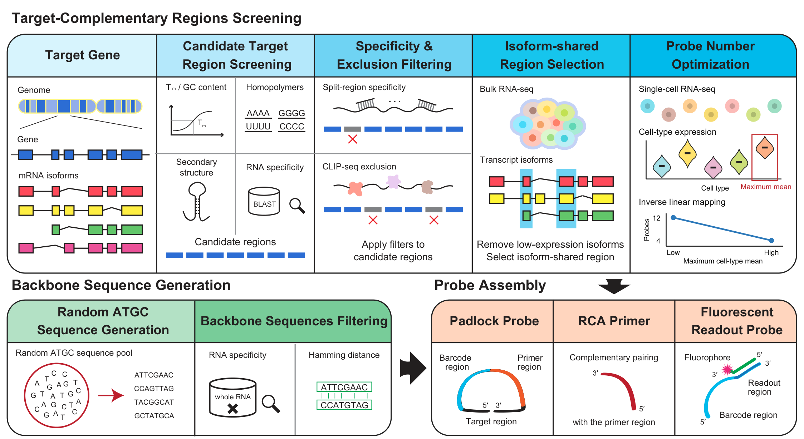
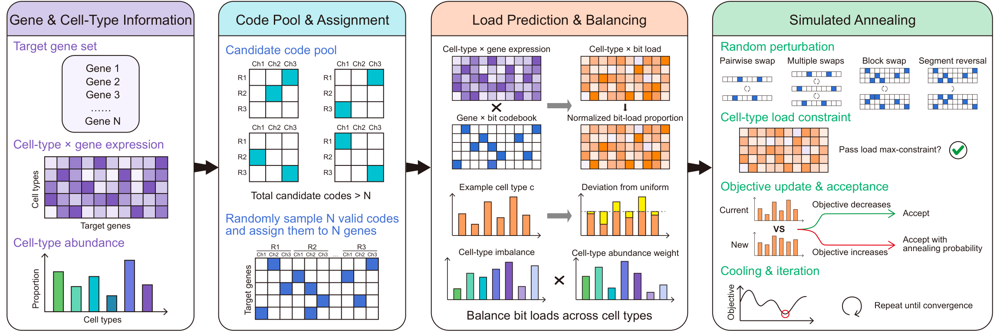

# Procode

### The scripts for article "Procode enables expression-guided probe and codebook design for RCA-based spatial transcriptomics".

## Probe design workflow

## Codebook design workflow

## Getting started

Procode uses expression information to guide padlock-probe design and binary
codebook optimization for imaging-based RCA spatial transcriptomics.
Probe numbers are allocated according to cell-type expression, and gene-codeword
assignments are optimized by simulated annealing to balance imaging-bit loads.
This repository contains the design algorithms, image-processing functions and
analysis scripts used in the study.

Probes and codebooks can be designed directly on the
**[online platform](https://www.bassfish.cn/probedesign/)**.
No local installation is needed to use the platform.

## Repository contents

| Directory | Contents | Source data |
| --- | --- | --- |
| [design](design/README.md) | Probe design, sequence assembly and binary codebook optimization | See module documentation |
| [processing](processing/README.md) | Image normalization, decoding and transcript-to-cell assignment | See module documentation |
| [figures/fig1](figures/fig1/README.md) | Probe-number response and Supplementary Fig. 2 | [fig1_data.xlsx](figures/fig1/fig1_data.xlsx) |
| [figures/fig2](figures/fig2/README.md) | Codebook comparison and Supplementary Fig. 3 | [fig2_data.xlsx](figures/fig2/fig2_data.xlsx) |
| [figures/fig3](figures/fig3/README.md) | Mouse-brain cell types and Supplementary Figs. 4-5 | [fig3_data.xlsx](figures/fig3/fig3_data.xlsx) |
| [figures/fig4](figures/fig4/README.md) | Glioblastoma cell types and Supplementary Fig. 6 | [fig4_data.xlsx](figures/fig4/fig4_data.xlsx) |

Each figure directory contains separate analysis scripts and one workbook,
with one table per worksheet. The workbooks contain the compact tables used
in the figure analyses. The figure README files describe the analysis scripts
and their input requirements.

## Data download

Processed cell-level AnnData (`.h5ad`) datasets for Figures 1-4 are available
from **[Quark Drive](https://pan.quark.cn/s/ef0c951a732b)**.

**Access code:** `Fcv7`
